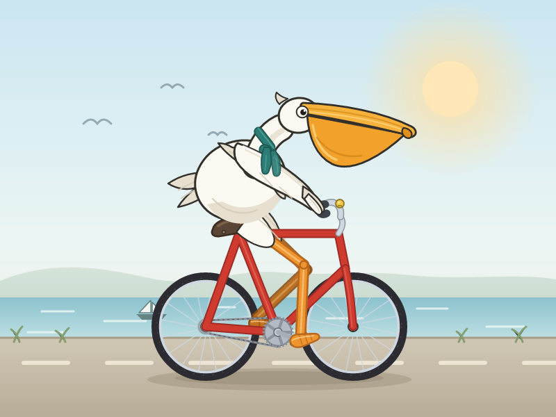

# 鹈鹕测试 · 一只骑自行车的鹈鹕

> 提示词只有一句：**Generate an SVG of a pelican riding a bicycle.**
> 交付物必须是一段能渲染的 SVG 源码 —— 不能调图像模型糊一张图，得用路径、圆、坐标
> 把「一只鸟骑在车上」这件事真正搭出来。

这是 Simon Willison 从 2024 年 10 月开始、一直用来横向对比各家模型的**非正式**基准
（不是 OpenAI / Anthropic 的官方评测）。新模型上线后，社区最常见的第一个拷问就是：
你画的鹈鹕，腿到底在不在踏板上。



## 文件

| 文件 | 是什么 |
|---|---|
| `index.html` | **直接双击打开就能看。** 单文件，内联 SVG + 原生 JS，零依赖、零构建、零外部资源 |
| `pelican.svg` | 同一幅画导出的独立 SVG（20 KB），可以单独引用或嵌进任何页面 |
| `build.py` | 真正的画稿：所有坐标、曲线、IK 都写在这，`python3 build.py` 重新生成上面两个文件 |
| `preview.png` | 上面那张预览图 |

页面里有三个按钮区：

- **▶ 让它骑起来** —— 曲柄、两条腿、两个轮子、牙盘全部实时转动，腿是每帧重新解 IK 的，不是播好的关键帧
- **下载 SVG** —— 把当前画面序列化成文件保存
- **空间检查 7/7** —— 页面加载时现算的几何自检，见下文

## 为什么「骑」这么难画

弱一点的输出通常是「**鸟 + 自行车**」，好一点的变成「**鸟在自行车旁边**」，真正过关的才
是「**鸟和车发生关系**」。这道题一次要同时做对四件事：

1. **空间关系** —— 屁股在座垫上、两只脚在踏板上、一只翅膀在车把上。最典型的失败是鹈鹕
   整体悬浮在车座上方二十像素。
2. **结构完整性** —— 两个轮子同高、车架闭合、链条真的连着牙盘和后飞轮。少一根管子，
   车就散架，人眼一秒看出来。
3. **概念组合** —— 大喙、喉囊、蹼足这些鹈鹕特征，得和自行车的几何拼成一个动作，
   而不是各画各的。
4. **可执行性** —— 输出的是代码，路径写错一个字符，浏览器就直接白屏。

## 这一版是怎么搭的

没有凭手感摆坐标。先定几个锚点，其余全部推出来：

```python
REAR_HUB  = (296, 470)   FRONT_HUB = (508, 470)   # 同一条 y，轮子才站得平
BB        = (400, 478)                            # 中轴，比轴心略低
SEAT_TOP  = (344, 336)   HEAD_TOP  = (487, 336)   # 上管水平，车架闭合
```

- **车架**：六根管子就是六条线段，座管/下管/上管/后下叉/后上叉/头管，画两遍（深色粗线
  + 亮色细线）得到描边效果；前叉用一条三次贝塞尔从车头勾到前轴。
- **轮组**：16 根辐条按 22.5° 步进生成，每根再额外倾斜 9°，这样看起来才是编出来的
  而不是画了个扇子。胎面上有一圈短划，转动时才看得出在转。
- **腿**：`two_bone_ik(hip, ankle, 106, 100)` 反解膝盖位置，脚踝锚在踏板轴的斜上方，
  所以脚永远咬在踏板上；两条曲柄相差 180°，一前一后。
- **羽毛**：大腿上盖一片羽状「裤腿」，膝盖以下留出裸露的橙色跗跖 —— 鸟不是从髋关节
  开始就光着的，这是让画面「像鸟」而不是「像一个球插了两根棍」的关键一步。
- **喙**：上颌骨是一条带钩的尖长形状，喉囊吊在下面，最深的地方在喉咙后方、往喙尖收，
  下颌线单独压一条暗线把两块结构分开。

## 自检：7/7

这些不是文案，是页面加载时用同一套几何现算的：

```
✓ 两个轮子同高         轴心 y = 470，差值 0.00px
✓ 轮胎着地             胎底 y = 542，地面 y = 542
✓ 腿（远侧）踩得到踏板  大腿 106.0px，小腿 100.0px，髋→踝 143.1px（弯曲量 62.9px）
✓ 腿（近侧）踩得到踏板  大腿 106.0px，小腿 100.0px，髋→踝 181.9px（弯曲量 24.1px）
✓ 两只脚都踩在曲柄圆上  (370, 466) / (430, 490)
✓ 翅膀够得着车把       肩→握把 134.0px
✓ 屁股在车座上方       髋关节距座垫中心 19.7px
```

前两条是车的问题，中间三条是「骑」的问题，最后两条是构图的问题。剩下没被代码检查、
只能靠眼睛的，是好不好看。

## 改它

```bash
cd docs/pelican-test
python3 build.py     # 改完 build.py 里的锚点，重新生成 index.html + pelican.svg
```

想让它换个姿势，最省事的是改 `NEAR_CRANK_DEG`（近侧曲柄角度）：两条腿、踏板、
脚掌方向会一起重算。想换车，改 `REAR_HUB` / `FRONT_HUB` / `BB`，但记得让两个轴心的
`y` 保持一致 —— 自检会替你盯着。

## 参考

- Simon Willison 的原始系列：<https://simonwillison.net/tags/pelican-riding-a-bicycle/>
- 社区常引用的提示词变体（中文）：`用 SVG 画一只正在骑自行车的鹈鹕。只返回完整的 SVG 代码，不要解释。`

顺带一句：这道题测不到今天最要紧的能力 —— **模型能不能在长对话里稳定地调用工具**。
那正是这个仓库 (`win-mcp-bridge`) 存在的理由。
